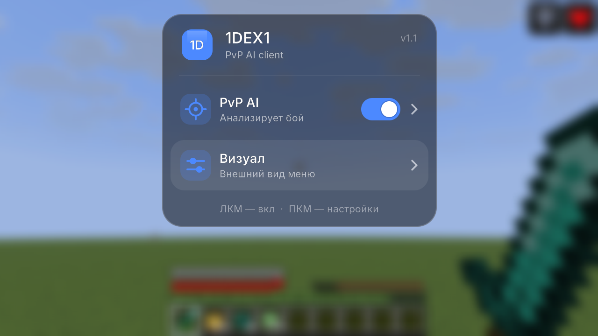
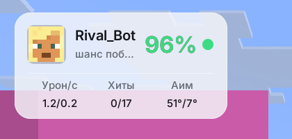

# 1DEX1 PvP AI — мод для Minecraft 1.21.11 (Fabric)

Клиентский мод: следит за игроками в прорисовке, анализирует бой и пишет **шанс победы** над противником.

Готовый файл: [`release/1DEX1-PvP-AI-1.1.0.jar`](release/1DEX1-PvP-AI-1.1.0.jar)

| Меню (F8) | Режим HUD | Над ником |
|---|---|---|
|  |  |  |

## Установка

1. Поставь **Fabric Loader** для Minecraft **1.21.11** (fabricmc.net → Installer).
2. Положи `1DEX1-PvP-AI-1.1.0.jar` в папку `.minecraft/mods`.
3. Fabric API ставить **не нужно**: всё нужное уже лежит внутри jar. Если Fabric API у тебя уже стоит, мод тоже будет работать.
4. Запусти игру и нажми **F8** (клавишу можно сменить: Настройки → Управление → «1DEX1 PvP AI»).

## Меню (F8)

Открывается и закрывается плавно. Никаких майнкрафтовских шрифтов и пикселей: шрифт Inter, все углы сглажены.
Меню почти не влияет на FPS: каждый блок рисуется из нескольких готовых текстур, а размытие в режиме «Стекло» считается в уменьшенном разрешении.

| Функция | ЛКМ | ПКМ |
|---|---|---|
| **PvP AI** | включить / выключить | открыть настройки |
| **Визуал** | открыть настройки | открыть настройки |

### Настройки PvP AI
- **Время анализа**: от 30 секунд (слабый анализ) до 5 минут (самый точный).
- **Режим отображения**:
  1. **Над ником**: процент и кружок возле ника противника. Зелёный кружок — шанс больше 60%, жёлтый — 40–60%, красный — меньше 40%. Пока идёт анализ, там написано `анализ 0:37`.
  2. **HUD**: компактная карточка: голова и ник противника, таймер анализа с полоской, потом процент и сравнение «вы/он» (урон в секунду, хиты, аим).
- **Размер HUD**: от 50% до 150%.
- **Прогноз для всех игроков**: показывает `~55%` над всеми игроками ещё до боя (по броне, оружию и их прошлым боям).
- **В анализе / в памяти**: сколько игроков мод видит сейчас и сколько помнит. Игрок попадает в память, как только он нанёс или получил урон в PvP.
- **Сбросить память**: нажать два раза.

### Как двигать HUD
Открой чат (**T**). HUD показывается даже без боя, в виде примера.
- **ЛКМ** — перетащить мышкой (двигается плавно).
- **Колесо мыши** — размер ±5%.
- **ПКМ** — сбросить позицию и размер.

### Настройки «Визуал»
- **Фон**: белый, серый или чёрный.
- **Тип**: обычный или стекло (с размытием).
- **Цвет**: палитра как в Photoshop. Квадрат задаёт насыщенность и яркость, полоса снизу — оттенок. Справа виден HEX-код.

## Как считается шанс победы

Мод только **читает** то, что сервер и так присылает клиенту. Он ничего не отправляет и ничего не делает за игрока.

Что мод отслеживает у каждого игрока в прорисовке:
- **Удары.** Кто кого ударил (пакеты урона) и сколько урона реально прошло (по изменению здоровья).
- **Взмахи и точность.** Попадания делятся на взмахи.
- **Криты, комбо, размен ударами.**
- **Аим.** Насколько прицел игрока отклоняется от противника, в градусах.
- **Стрейфы.** Боковое движение относительно противника.
- **Тайминг кулдауна.** Сколько урона наносится относительно удара с полной зарядкой.
- **Расходники.** Гэплы, зачарованные гэплы, зелья, жемчуг, тотемы (каждый поп).
- **Снаряжение.** Броня, прочность брони, зачарование «Защита», оружие и «Острота».
- **Лечение.** Сколько HP в секунду восстанавливает каждый игрок.

Расчёт:
1. **Урон в секунду** каждого игрока: реально измеренный в бою плюс ожидаемый по оружию и броне (точная формула урона из ванильного Minecraft).
2. **Эффективное здоровье**: HP + поглощение + запас лечения. Свой инвентарь мод видит точно. У противника запас оценивается по броне и по тому, что он уже съел или выпил.
3. **Время до убийства** для обеих сторон (с учётом его лечения). Тот, кто убивает быстрее, получает больший шанс.
4. **Поправка на скилл**: точность, аим, криты, размен, стрейфы, кулдаун.
5. **Защита от ложной уверенности**: чем короче анализ, тем ближе процент к 50%. Поэтому 5 минут точнее, чем 30 секунд.

Профили игроков хранятся в `.minecraft/config/1dex1-pvpai-profiles.json`, настройки — в `.minecraft/config/1dex1-pvpai.json`.

## Ограничения (честно)
- Инвентарь противника клиент не видит, поэтому его запас гэплов и тотемов — это **оценка**.
- Некоторые серверы скрывают здоровье других игроков. Мод это замечает и переходит на расчёт урона по формуле, а точность анализа понижается.
- Если на сервере скрыты ники (scoreboard teams), режим «Над ником» не будет виден. Тогда используй HUD.

## Сборка из исходников
```
./gradlew build
```
Готовый файл: `build/libs/1DEX1-PvP-AI-1.1.0.jar`.

Шрифт Inter распространяется по лицензии SIL Open Font License 1.1 (файл `LICENSE-Inter-OFL.txt` внутри jar).
